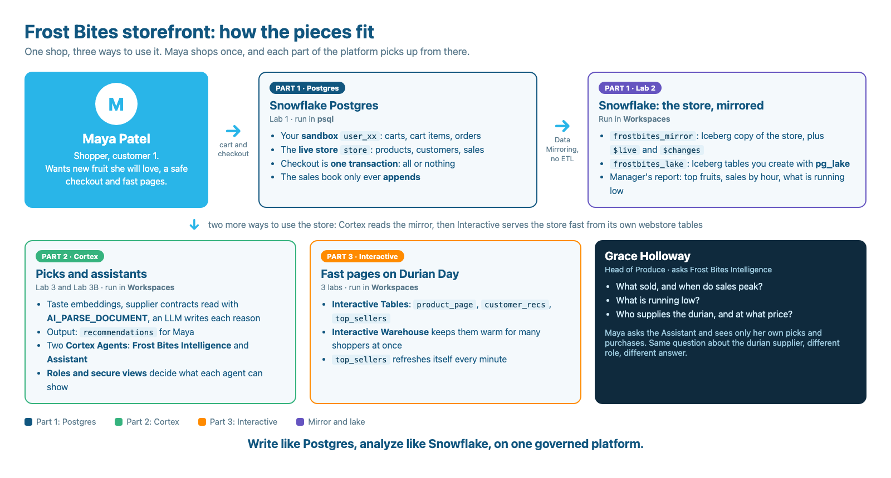

# Frost Bites storefront: hands-on lab

Build an online exotic-fruit store on Snowflake, then make it smart and fast.

You follow one shopper, **Maya Patel**, from her first cart to her personal fruit picks. Along the way you use Snowflake Postgres, Cortex and Interactive Tables on one governed platform.

> **Write like Postgres, analyze like Snowflake, on one governed platform.**

## Maya's story

Maya is shopper number 1 at Frost Bites, a store with 35 fruits most people have never tried. As Maya, you want to:

1. find fruit you will love
2. build a cart you can change
3. check out without losing your order
4. get picks that fit you, and ask questions in plain English
5. see pages that stay fast on Durian Day

Grace Holloway, the Head of Produce, wants the other side: what sold, what is running low, and who supplies it.

## The path

Do the parts in order. Each part builds on the one before.

| Part | Lab | Where you run it | What you do |
|---|---|---|---|
| Start | [Prerequisites](transactions-lab/labs/prerequisites.md) | | Connect to Postgres and to Snowflake |
| 1. Postgres | [Lab 1: your sandbox, your first order](transactions-lab/labs/lab1_cart.sql) | psql | Build a cart, check out safely |
| 1. Postgres | [Lab 2: Postgres to Snowflake](transactions-lab/labs/lab2_mirror_and_lake.sql) | Workspaces and psql | Mirror the store, build a report |
| 2. Cortex | [Lab 3: recommendations](transactions-lab/labs/lab3_cortex.sql) | Workspaces | Pick fruit for Maya with AI |
| 2. Cortex | [Lab 3B: two assistants](transactions-lab/labs/lab3b_assistants.sql) (optional) | Workspaces | Manager and shopper agents, one store |
| 3. Interactive | [Interactive Tables lab](interactive-labs/labs/lab.sql) (three labs in one file) | Workspaces | Serve pages fast, keep them fresh |
| Bonus | [Lab 4: Hybrid Tables](transactions-lab/labs/lab4_hybrid_tables.sql) | Workspaces | The same checkout, inside Snowflake |

**Where to paste.** Lab 1 runs in psql, not in a worksheet. Paste one step at a time and check the result under it before you go on. Every other lab runs in a Workspaces SQL file.

## Maya's journey, step by step

### Part 1: Postgres (Labs 1 and 2)

1. **Browse.** Maya sees the 35 fruits on the shelf (Lab 1.1).
2. **The shop protects itself.** You try to set stock to -5, add an item to a cart that doesn't exist, and register a second account with her email. The database rejects all three (1.2).
3. **Build a cart.** 3 dragon fruit, 2 rambutan, 4 star fruit (1.3).
4. **Change her mind.** An UPSERT turns 3 dragon fruit into 5 and adds a mangosteen. Run it twice and nothing breaks (1.4).
5. **Check out.** First the risky way, then in one transaction. Someone tries to buy 999 durians and the whole order rolls back. The sales book only ever appends (1.5 to 1.8).
6. **Her order shows up in Snowflake.** You watch the checkout land in the mirror, read the change feed, and see the live shelf (Lab 2, Part A).
7. **Grace gets her report.** Top 10 fruits, sales by hour, what is running low, pinned to a dashboard. You also create your own Iceberg table in Postgres with pg_lake and find it in Snowflake (Lab 2, Part B).

### Part 2: Cortex (Labs 3 and 3B)

8. **Picks for Maya.** Start with a plain "bought together" list. Add taste with embeddings, read the supplier contracts with `AI_PARSE_DOCUMENT`, blend it all into a score, and let an LLM write one friendly reason per pick. Compare her picks before and after AI (Lab 3).
9. **Two assistants, one store.** The manager's agent answers questions about sales, stock and suppliers. Maya's agent sees only her own picks, purchases and fruit facts (Lab 3B).
10. **The same question, two answers.** Ask both agents who supplies the durian. The manager gets the supplier and price, and Maya's assistant says it can't tell. Roles and secure views set that scope, not the prompt.

### Part 3: Interactive (three labs)

11. **Tomorrow is Durian Day.** Thousands of shoppers will open product pages at once. You turn the two busiest queries into Interactive Tables (`product_page`, `customer_recs`).
12. **Keep them warm.** An Interactive Warehouse serves the lookups, and you compare timings against a normal warehouse.
13. **The flash sale starts.** `top_sellers` refreshes itself every minute, with no pipeline and no manual rebuild.

## How to guide the room

**Before class.** The instructor runs the setup scripts once and checks that everything works. Attendees get a hero name (for example `batman`), a Snowflake login and the Postgres password.

**During class.**
1. Spend about 15 minutes on the talk track, then show the diagram above.
2. Walk through the labs in the order on this page. Say which tool each lab uses.
3. Tell attendees to run one step at a time and compare with the `expect` line under it.
4. Call out the steps that are meant to fail, so nobody thinks they broke something. In Lab 1.2 the guard rails reject bad data, and in Lab 3B step 3.11 the shopper can't read the supplier tables.
5. The mirror syncs about every minute. If a result isn't there yet, wait a moment and run it again.
6. AI steps (embeddings, contract reading, the LLM reasons, the agents) take seconds to a couple of minutes.

**What to say at the end.** One governed platform: the app database, the AI, the fast reads and the analytics all use the same roles and the same data.

## Notes

- The interactive lab is one file, [`lab.sql`](interactive-labs/labs/lab.sql), with three labs in it. Search and replace `_xx` with your hero name (for example `dba_xx` becomes `dba_batman`).
- The interactive lab needs the webstore data (`products`, `customers`, `orders`, `order_items` and `recommendations`) and the `std_wh_xx` warehouse. Your instructor builds them before the lab. That setup rebuilds `recommendations`, so it should run before Lab 3 (Cortex), or Maya's AI picks are replaced.
- The Transactions labs need no search and replace, except `lake_xx` in Lab 2 step 2.6.
- Data Mirroring is in Public Preview on AWS and Azure.
